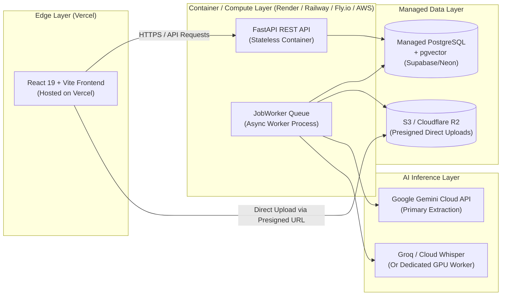

# MEMORA — Comprehensive Vercel & GitHub Deployment Audit

**Date:** November 24, 2026  
**Auditor:** Antigravity AI  
**Scope:** Read-Only Full Architecture & Deployment Inspection  
**Target Deployment:** GitHub (Public Repository) + Vercel (Hosting)

---

## Executive Summary

MEMORA is architected as a high-performance **hybrid AI monolith** comprising:
1. A **React 19 + Vite Single Page Application (SPA)** with TypeScript.
2. A **FastAPI Python 3.13 Backend** running an asynchronous background job queue (`JobWorker`), a media retention scheduler, local SQLite with Write-Ahead Logging (WAL) and FTS5 search, local CTranslate2/faster-whisper GPU models, local PyTorch Multilingual-E5 embeddings, and local Ollama Qwen 3 8B integration alongside Google Gemini Cloud API.

### Can MEMORA be deployed to Vercel?
- **Frontend (Yes, Seamlessly):** The React + Vite frontend can be deployed directly to Vercel as a static SPA with zero architectural changes.
- **Backend (No, Impossible on Vercel Serverless):** The FastAPI backend **cannot** run on Vercel serverless functions without major re-architecture due to Vercel's hard 4.5 MB upload body limit, 15–60s execution timeouts, ephemeral read-only filesystem, absence of GPUs, lack of background daemons, and package size limits.
- **Recommended Production Topology:** 
  - **Frontend:** Vercel (Fast edge CDN, zero maintenance).
  - **Backend & Worker:** Persistent container platform (Render, Railway, Fly.io, or AWS ECS/EC2) with managed PostgreSQL and S3/R2 storage.

---

## 1. Frontend Framework & Folder Location

- **Framework:** React 19 (`react: ^19.3.1`, `react-dom: ^19.3.1`)
- **Build Tool / Bundler:** Vite 8.3.6 (`@vitejs/plugin-react: ^6.1.2`)
- **Language:** TypeScript 7.0 (`tsc -b && vite build`)
- **Icons & Styling:** Lucide React (`^1.73.0`), Vanilla CSS with modern theme tokens
- **Type:** Single Page Application (Client-Side Rendered SPA)
- **Folder Location:**
  `frontend/` (Absolute: `c:\Users\gurpr\Downloads\Multilingual Meeting Intelligence System\frontend`)

---

## 2. Location of `package.json` & Build Scripts

- **Location:** `frontend/package.json`  
  (Absolute: `c:\Users\gurpr\Downloads\Multilingual Meeting Intelligence System\frontend\package.json`)
- **Scripts:**
  ```json
  "scripts": {
    "dev": "vite",
    "build": "tsc -b && vite build",
    "lint": "oxlint",
    "test": "node --experimental-strip-types --test src/tests/async_security.test.mjs src/tests/intelligence_frontend.test.mjs src/tests/memory_frontend.test.mjs src/tests/cross_meeting_frontend.test.mjs src/tests/ask_ai_structured_presentation.test.mjs src/tests/pipeline_stepper.test.mjs src/tests/usability_final_pass.test.mjs src/tests/floating_ask_memora_and_org_auth.test.mjs",
    "preview": "vite preview"
  }
  ```
- **Build Output Directory:** `frontend/dist/` (contains static `index.html`, JavaScript bundles, and CSS).

---

## 3. Frontend Framework Verification

- The frontend is **strictly React + Vite**.
- It is **not** Next.js, Remix, Nuxt, Astro, or SvelteKit.
- Because it has no Server-Side Rendering (SSR) requirements, it compiles to pure static HTML, JS, and CSS that any CDN or static hosting platform can serve immediately.

---

## 4. FastAPI Backend Entry Point & Folder Location

- **Folder Location:** `backend/`  
  (Absolute: `c:\Users\gurpr\Downloads\Multilingual Meeting Intelligence System\backend`)
- **Exact Entry Point:** `backend/app/main.py`
- **Application Instance:** `app = FastAPI(...)`
- **Startup Lifespan Routine (`@asynccontextmanager lifespan`):**
  1. `configure_cpu_resources()`: Strictly binds PyTorch, OpenMP, and BLAS CPU threads.
  2. `reconcile_stranded_jobs_on_startup(db)`: Reconciles stranded database jobs on startup.
  3. `JobWorker(poll_interval=2.0).start()`: Asynchronous background worker polling SQLite for media ingestion, Whisper transcription, intelligence extraction, and embedding jobs.
  4. `RetentionScheduler.start()`: Runs scheduled raw media privacy cleanup loops.

---

## 5. All API Endpoints Used by the Frontend

The frontend communicates with the backend via 50+ specialized REST endpoints defined in `frontend/src/services/api.ts`:

### A. Health & Diagnostics
- `GET /` — Backend service metadata.
- `GET /health` — Application health check (database connection verification).
- `GET /api/v1/transcription/hardware/diagnostics` — GPU/CPU/VRAM hardware diagnostics (Super-Admin gated).

### B. Authentication, Organizations & RBAC
- `POST /api/v1/auth/register` — User and workspace registration.
- `POST /api/v1/auth/login` — OAuth2/JWT token login with email & password.
- `GET /api/v1/auth/me` — Active user profile and tenant memberships.
- `POST /api/v1/auth/logout` — Server-side token revocation.
- `GET /api/v1/auth/organizations` — Available tenant organizations.
- `GET /api/v1/auth/organizations/by-domain?domain=...` — Domain lookup for corporate join.
- `POST /api/v1/auth/verify-domain` — Corporate domain verification.
- `GET /api/v1/auth/organization/members` — Organization roster.
- `PATCH /api/v1/auth/organization/members/{membershipId}/role` — Role modification (`ORG_ADMIN`, `MEMBER`).

### C. Media Ingestion & Processing
- `POST /api/v1/media/upload` — Multipart media upload with XHR progress tracking.
- `POST /api/v1/media/youtube` — YouTube URL audio/video streaming ingestion.
- `GET /api/v1/media/meetings` — Meeting list with pagination and date/project filters.
- `GET /api/v1/media/meetings/{meetingId}` — Meeting detail view.
- `DELETE /api/v1/media/meetings/{meetingId}` — Complete meeting deletion.
- `DELETE /api/v1/media/meetings/{meetingId}/audio` — Raw audio deletion (privacy enforcement).
- `GET /api/v1/media/meetings/{meetingId}/export/pdf` — PDF meeting intelligence export.
- `GET /api/v1/media/assets/{assetId}` — Physical media asset record.
- `GET /api/v1/media/jobs/{jobId}` — Active background job polling.
- `POST /api/v1/media/jobs/{jobId}/retry` — Pipeline stage job retry.
- `GET /api/v1/media/meetings/{meetingId}/participants` — Meeting speaker roster.
- `PATCH /api/v1/media/meetings/{meetingId}/participants/{participantId}` — Speaker label renaming.

### D. Transcription & Privacy Redaction (ASR)
- `POST /api/v1/transcription/start/{meetingId}` — Start Whisper ASR pipeline.
- `GET /api/v1/transcription/{meetingId}` — Retrieve meeting transcripts (`ORIGINAL`, `CLEANED_REDACTED`).
- `GET /api/v1/transcription/{meetingId}/default` — Retrieve default privacy-safe transcript.
- `POST /api/v1/transcription/{meetingId}/clean` — Execute filler word cleaning derivation.
- `POST /api/v1/transcription/{meetingId}/redact` — Execute PII & secret redaction derivation.
- `POST /api/v1/transcription/{meetingId}/process` — Combined derivation workflow.
- `GET /api/v1/transcription/jobs/{jobId}` — ASR job polling.

### E. Structured Meeting Intelligence
- `GET /api/v1/meetings/{meetingId}/intelligence` — Retrieve summary, topics, decisions, actions, risks, questions.
- `POST /api/v1/meetings/{meetingId}/intelligence/extract` — Enqueue structured intelligence extraction.
- `PATCH /api/v1/action-items/{itemId}/status` — Update commitment status (`PENDING`, `IN_PROGRESS`, `COMPLETED`, `BLOCKED`).

### F. Cross-Meeting RAG & Organizational Memory
- `POST /api/v1/memory/query` — Dual-source RAG question answering with verified citations.
- `POST /api/v1/memory/search` — Hybrid E5 vector + FTS5 keyword memory search.
- `GET /api/v1/decisions` — Cross-meeting decision timeline.
- `GET /api/v1/decisions/{decisionId}` — Decision detail.
- `POST /api/v1/decisions/{decisionId}/supersede` — Supersede earlier decision.
- `POST /api/v1/decisions/{decisionId}/link-superseded` — Link contradictory decisions.
- `POST /api/v1/decisions/{decisionId}/revoke` — Revoke superseded decision.
- `GET /api/v1/commitments` — Cross-meeting commitments.
- `GET /api/v1/commitments/{actionItemId}` — Commitment detail.
- `POST /api/v1/commitments/{actionItemId}/reviews` — Review commitment across meetings.
- `GET /api/v1/questions` — Unresolved question tracking.
- `GET /api/v1/questions/{questionId}` — Question detail.
- `POST /api/v1/questions/{questionId}/resolve` — Mark question resolved.
- `POST /api/v1/questions/{questionId}/reopen` — Reopen question.
- `GET /api/v1/conflicts` — Contradiction and conflict detection.

### G. Projects & Categories
- `GET /api/v1/projects` — List projects.
- `POST /api/v1/projects` — Create project.
- `GET /api/v1/projects/{projectId}` — Project details.
- `PATCH /api/v1/projects/{projectId}` — Update project.
- `DELETE /api/v1/projects/{projectId}` — Delete project.

---

## 6. How the Frontend Connects to the Backend

1. **Base URL Resolution:**
   Configured in `frontend/src/services/api.ts` line 46:
   ```typescript
   const API_BASE_URL = import.meta.env?.VITE_API_URL || 'http://127.0.0.1:8000';
   ```
2. **Local Development Proxy:**
   In `frontend/vite.config.ts`, Vite proxies `/api` and `/health` to `http://127.0.0.1:8000`.
3. **Authentication Handshake:**
   The frontend attaches the bearer token from browser `sessionStorage` (`meet_intel_token`):
   ```http
   Authorization: Bearer <jwt_access_token>
   X-Organization-Id: <selected_org_id>
   ```
4. **Binary & Media Uploads:**
   Uploads use direct `XMLHttpRequest` to track progress percentages (`0% - 100%`) before enqueuing asynchronous backend processing jobs.

---

## 7. Required Environment Variables

*(Never commit actual secrets or API keys to GitHub).*

### Frontend Variables (`frontend/.env` / Vercel Environment Variables)
| Variable | Description | Example / Required in Production |
|---|---|---|
| `VITE_API_URL` | Public URL of the hosted FastAPI backend | `https://api.memora.yourdomain.com` |

### Backend Variables (`backend/.env` / Hosted Container Environment Variables)
| Variable | Description | Deployment Requirement |
|---|---|---|
| `PROJECT_NAME` | Name of application | `Multilingual Meeting Intelligence System` |
| `ENVIRONMENT` | Runtime environment | `production` |
| `DEBUG` | FastAPI debug mode | `False` |
| `API_V1_STR` | Versioned prefix | `/api/v1` |
| `SECRET_KEY` | JWT signing secret | **CRITICAL: Generate strong 64-char random string** |
| `JWT_ALGORITHM` | Algorithm for tokens | `HS256` |
| `ACCESS_TOKEN_EXPIRE_MINUTES`| Expiry duration | `60` |
| `ALLOWED_ORIGINS` | CORS allowed origins | **CRITICAL: Must include frontend Vercel URL** |
| `DATABASE_URL` | Relational database connection string | Managed PostgreSQL (`postgresql+psycopg2://...`) |
| `STORAGE_DIR` | Media directory | Path to persistent storage or S3 mount |
| `MAX_UPLOAD_SIZE_BYTES` | File upload ceiling | `524288000` (500 MB) |
| `GEMINI_ENABLED` | Enable Google Gemini API | `True` |
| `GEMINI_API_KEY` | Gemini Cloud API key | **CRITICAL: Production API key** |
| `GEMINI_MODEL` | Generative Gemini model | `gemini-3.8-flash` |
| `GEMINI_REQUEST_TIMEOUT_SECONDS` | API timeout | `120.0` |
| `OLLAMA_BASE_URL` | Ollama URL (if hosted GPU worker used) | `http://<worker-ip>:11434` |
| `LLM_MODEL_NAME` | Ollama model identifier | `qwen3:8b` |
| `ASR_ENGINE` | ASR transcription library | `faster-whisper` |
| `ASR_DEVICE` | Compute device | `cuda` (if GPU available) or `cpu` |
| `ASR_COMPUTE_TYPE` | Precision type | `float16` (CUDA) or `int8` (CPU) |
| `MEMORY_EMBEDDING_MODEL_NAME` | Embedding model identifier | `intfloat/multilingual-e5-small` |

---

## 8. Database Type & Local SQLite Inspection

- **Current Database:** Local file-based **SQLite** (`meeting_intelligence.db` in project root).
- **SQLite Pragmas & Engine Configuration:**
  - Foreign keys: `PRAGMA foreign_keys=ON;`
  - Concurrency & locking: `PRAGMA busy_timeout=30000;` (30s timeout)
  - Journal mode: `PRAGMA journal_mode=WAL;`
  - Synchronous: `PRAGMA synchronous=NORMAL;`
- **Full-Text Search:** Uses SQLite's built-in **FTS5** virtual table extension (`transcript_chunk_fts`) for BM25 keyword search.
- **Production Implication:** SQLite requires a persistent, single-host local filesystem. It **cannot** run across ephemeral serverless instances (like Vercel functions). For cloud deployment, the database must be migrated to managed PostgreSQL with `pgvector` or Supabase.

---

## 9. Storage Location of Files, Media, Transcripts & Embeddings

1. **Raw Video & Audio:**
   - Physical directory: `data/storage/<meeting_id>/<asset_id>.<ext>`
   - Stored on host disk.
2. **Normalized Audio:**
   - Physical directory: `data/storage/<meeting_id>/normalized_16k_<asset_id>.wav`
   - Generated during ingestion via `ffmpeg`.
3. **Downloaded AI Models:**
   - Physical directory: `data/storage/models/` (CTranslate2 Whisper models: 1.5–3 GB each).
4. **Transcripts & Utterances:**
   - Stored in SQLite database tables (`transcripts`, `transcript_segments`) with start/end timestamps and speaker tags.
5. **Embeddings & Vector Index:**
   - Stored as binary blobs (`BLOB` in column `vector_blob` in table `transcript_chunk_embeddings`).
   - Keyword index stored in SQLite FTS5 table `transcript_chunk_fts`.

---

## 10. AI Model Dependencies (Ollama, Whisper, GPU)

MEMORA's AI architecture has specific compute requirements:

| Component | Model / Engine | Hardware Dependency | Cloud Compatibility |
|---|---|---|---|
| **ASR (Speech-to-Text)** | `faster-whisper` (`large-v3-turbo`) | NVIDIA GPU (CUDA / cuDNN) or multi-core CPU + local `ffmpeg` | Requires GPU container or external API (e.g., Groq / OpenAI Whisper) |
| **Embeddings** | `intfloat/multilingual-e5-small` | PyTorch on CPU or GPU (~300MB RAM) | Can run on container CPU (e.g. 1 vCPU, 2GB RAM) |
| **Primary Intelligence** | Google Gemini (`gemini-3.8-flash`) | Cloud API (REST HTTP) | 100% Cloud compatible via API key |
| **Secondary Intelligence** | Local Ollama (`qwen3:8b`) | NVIDIA RTX 5060 (8GB VRAM) running local daemon | Requires dedicated GPU host or can be bypassed in pure-cloud mode |
| **Tertiary Intelligence** | Deterministic Regex & Rule Engine | Pure Python standard library | 100% Cloud compatible |

---

## 11. Can the Project Run on Vercel Without Major Modifications?

### **Verdict: NO for the Full Monolith; YES for the Frontend.**

Vercel is a **Serverless Function & Static Edge platform**. Deploying the full existing project directly to Vercel will fail immediately due to fundamental architectural mismatches:

| Requirement | MEMORA Current Architecture | Vercel Serverless Limits | Result on Vercel |
|---|---|---|---|
| **Media Upload Size** | Supports up to 500 MB video/audio | 4.5 MB hard limit on request body | **CRITICAL BLOCKER** (HTTP 413 Payload Too Large) |
| **Transcription Runtime** | 1–5 minutes per meeting | 15s (Hobby) / 60s (Pro) timeout | **CRITICAL BLOCKER** (Function Timeout) |
| **Background Daemons** | `JobWorker` & `RetentionScheduler` loop | Zero support for background processes | **CRITICAL BLOCKER** (Worker never runs) |
| **Filesystem Persistence** | Local SQLite + `data/storage/` | Ephemeral `/tmp` wiped on container cycle | **CRITICAL BLOCKER** (Data lost instantly) |
| **Hardware Compute** | CTranslate2 + PyTorch + NVIDIA CUDA | No GPU support, strict CPU quotas | **CRITICAL BLOCKER** (Whisper crashes) |
| **System Binaries** | Local `ffmpeg` subprocess | No default `ffmpeg` binary | **CRITICAL BLOCKER** (Audio extraction fails) |
| **Bundle Size** | Python virtual environment > 4 GB | 250 MB maximum uncompressed size | **CRITICAL BLOCKER** (Deployment rejected) |

---

## 12. Recommended Component Decoupling for Deployment

To achieve a resilient, public production deployment using GitHub and Vercel, decouple the components as follows:



---

## 13. Comprehensive Deployment Blockers & Mitigation Plan

### Blocker 1: Local SQLite Database
- **Impact:** SQLite is a local file. On Vercel or ephemeral containers, the database is reset or corrupted on every deployment or instance restart.
- **Mitigation:** Switch `DATABASE_URL` in `backend/app/core/config.py` from SQLite to managed PostgreSQL (e.g. Supabase, Neon, AWS RDS). Run Alembic migrations against the PostgreSQL database.

### Blocker 2: Media Upload Limits (Vercel 4.5 MB Gateway Limit)
- **Impact:** Video/audio meeting files are typically 20 MB – 500 MB. Vercel rejects any request payload larger than 4.5 MB.
- **Mitigation:** Implement S3 / Cloudflare R2 Presigned URLs. The frontend requests an upload URL from FastAPI, uploads the audio directly from the browser to S3, and notifies the backend to enqueue the job.

### Blocker 3: Execution Timeouts & Background Workers
- **Impact:** Faster-Whisper takes minutes to transcribe. Vercel terminates serverless functions after 15–60 seconds. Furthermore, `app.state.job_worker` cannot run in serverless.
- **Mitigation:** Host the backend on a persistent container platform (Render, Railway, Fly.io, or AWS ECS) where background worker threads continue running indefinitely without execution timeouts.

### Blocker 4: Local `ffmpeg` Binary
- **Impact:** `backend/app/services/audio_extraction.py` executes `ffmpeg` via Python `subprocess`.
- **Mitigation:** Include `ffmpeg` in a standard `Dockerfile` (`apt-get install -y ffmpeg`) on the container host.

### Blocker 5: CORS Policy
- **Impact:** When the frontend is hosted at `https://memora.vercel.app`, the backend will reject requests with `CORS Policy Blocked` because `ALLOWED_ORIGINS` currently only allows `localhost`.
- **Mitigation:** Set `ALLOWED_ORIGINS=https://memora.vercel.app,https://*.vercel.app` in the backend environment variables.

### Blocker 6: JWT Security Key
- **Impact:** In `backend/app/core/config.py`, `SECRET_KEY` defaults to empty string if not provided in `.env`.
- **Mitigation:** Provide a cryptographically secure 64-character random string via environment variable `SECRET_KEY`.

---

## 14. `.gitignore` & Sensitive File Inspection (GitHub Readiness)

We inspected the repository's `.gitignore` and tracked git files:

### Sensitive Files Verified As Ignored (Safe)
- `backend/.env` (Contains real API keys and secrets — **Safely ignored**)
- `frontend/.env` (**Safely ignored**)
- `meeting_intelligence.db`, `*.db`, `*.sqlite`, `*.db-wal` (Local databases — **Safely ignored**)
- `data/storage/` (Raw uploaded audio and video — **Safely ignored**)
- `data/storage/models/` (CTranslate2/Whisper model caches — **Safely ignored**)
- `venv/`, `backend/venv/` (**Safely ignored**)
- `node_modules/`, `frontend/dist/` (**Safely ignored**)

### Only Example Configuration Files Are Tracked (Safe)
- `backend/.env.example`
- `frontend/.env.example`

### Pre-Push Checklist for GitHub:
1. Run `git status` to ensure `backend/.env` is never staged.
2. Confirm that `meeting_intelligence.db` is never tracked.
3. Ensure no private transcripts or meeting recordings in `data/storage/` are committed.

---

## 15. Step-by-Step Vercel Deployment Guide for Frontend

To deploy the **MEMORA Frontend** to Vercel right now:

1. **Push Repository to GitHub:**
   Ensure code is pushed to your private or public GitHub repository.
2. **Import into Vercel:**
   - Go to [vercel.com](https://vercel.com) and click **"Add New Project"**.
   - Select your GitHub repository.
3. **Configure Project Settings in Vercel:**
   - **Framework Preset:** `Vite`
   - **Root Directory:** Click edit and select `frontend`
   - **Build Command:** `npm run build` (or `tsc -b && vite build`)
   - **Output Directory:** `dist`
   - **Install Command:** `npm install`
4. **Environment Variables in Vercel:**
   - Add `VITE_API_URL` = `https://your-hosted-backend-api.com` (point to your deployed backend URL).
5. **Deploy:**
   Click **Deploy**. Your frontend will be live on Vercel's global edge network in ~45 seconds.
