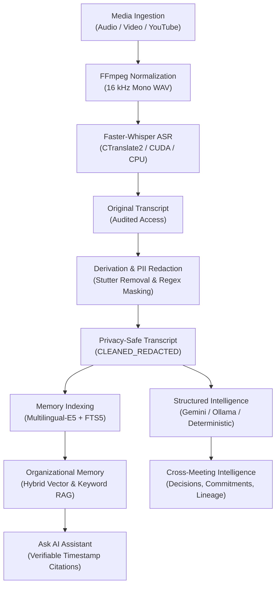
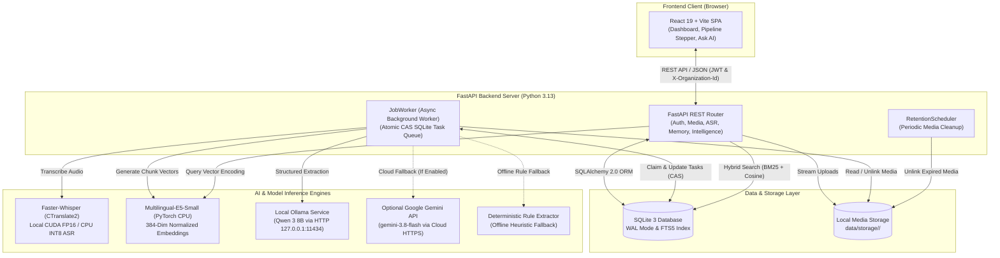
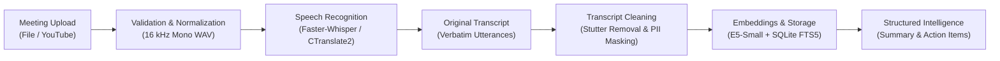
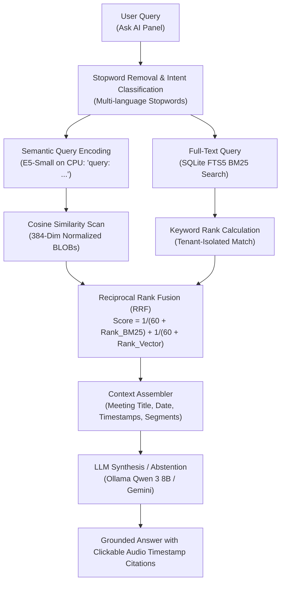
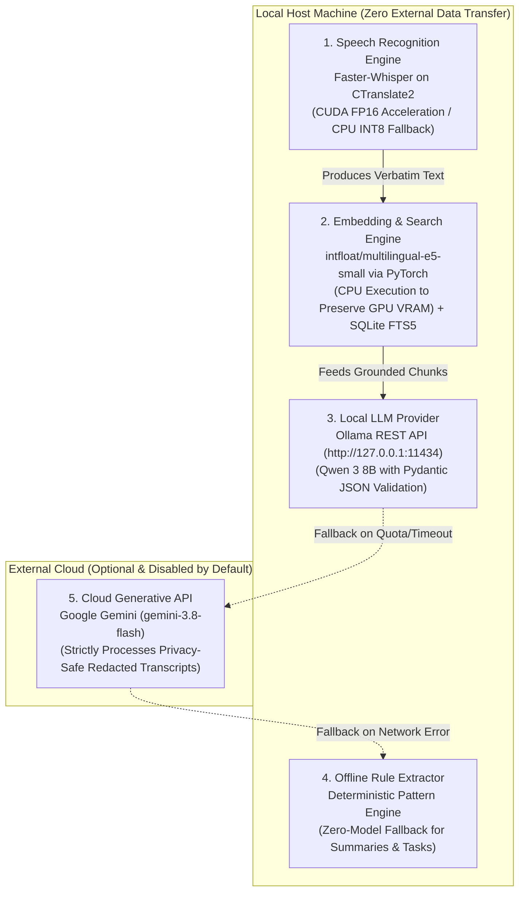

# MEMORA

### Multilingual Meeting Intelligence System

[](https://www.python.org/)
[](https://fastapi.tiangolo.com/)
[](https://react.dev/)
[](https://www.typescriptlang.org/)
[](https://vite.dev/)
[](https://github.com/SYSTRAN/faster-whisper)
[](https://github.com/OpenNMT/CTranslate2)
[](https://www.sqlite.org/)

An enterprise-grade meeting intelligence and organizational memory system designed to transcribe multilingual discussions (including code-switched Hindi-English / Hinglish), sanitize sensitive personal data, extract structured decisions and action items, and unify cross-meeting knowledge through hybrid vector and keyword retrieval with verifiable timestamp citations.

---

## Table of Contents

- [Overview](#overview)
- [Screenshots / Demo](#screenshots--demo)
- [Key Features](#key-features)
- [How It Works](#how-it-works)
- [System Architecture](#system-architecture)
- [Technology Stack](#technology-stack)
- [Local Installation and Setup](#local-installation-and-setup)
- [AI Model Configuration](#ai-model-configuration)
- [Privacy and Security](#privacy-and-security)
- [Project Structure](#project-structure)
- [Current Status and Limitations](#current-status-and-limitations)
- [Future Improvements](#future-improvements)
- [Contributors and License](#contributors-and-license)

---

## Overview

Organizations generate hours of audio and video recordings daily across planning, engineering, and cross-functional meetings. Traditional meeting tools create isolated, single-meeting transcript dumps that quickly become unsearchable silos. Key decisions are forgotten, commitments slip through the cracks, and team members cannot determine whether new proposals contradict past policies. Furthermore, uploading raw conversational recordings to generic third-party cloud services presents severe data leakage and privacy compliance risks.

MEMORA solves these challenges by transforming raw conversational recordings into an active, searchable organizational knowledge base:

- **From Audio to Knowledge**: Ingests audio, video, or authorized YouTube streams, normalizes the media, and runs hardware-accelerated multilingual transcription.
- **Privacy-by-Design**: Enforces dual-layer transcript derivation—stripping conversational disfluencies and redacting sensitive PII before text is stored or indexed.
- **Cross-Meeting Intelligence**: Unifies decisions, action items, risks, and unresolved topics across projects and time, enabling teams to trace decision lineage and detect contradictions.
- **Citation-Grounded AI**: The interactive Ask AI interface retrieves answers from past meetings using hybrid dense-vector and full-text search, grounding every claim in exact timestamped transcript segments.

Unlike simple transcription or note-taking apps that treat meetings in isolation, MEMORA establishes a persistent, cross-meeting memory system built around privacy, verifiable evidence, and local-first execution.

---

## Screenshots / Demo

The application provides an intuitive single-page dashboard for managing meetings, monitoring processing pipelines, and exploring organizational memory.

```
+---------------------------------------------------------------------------------------------------+
|  MEMORA Dashboard                                                       [Org: Engineering] [User] |
+---------------------------------------------------------------------------------------------------+
|                                                                                                   |
|  Pipeline: [ 1. Ingestion ] -> [ 2. Multilingual ASR ] -> [ 3. Derivation ]                       |
|                             -> [ 4. Memory Index ]    -> [ 5. Intelligence ]                      |
|                                                                                                   |
|  +--------------------------------------------+  +---------------------------------------------+  |
|  | Single Meeting View                        |  | Ask AI & Organizational Memory              |  |
|  | - Executive Summary                        |  | - Cross-meeting question answering          |  |
|  | - Categorized Agenda Topics                |  | - Verifiable timestamp citations            |  |
|  | - Binding Decisions & Ownership            |  | - Decision history & conflict detection     |  |
|  | - Action Items with Status & Deadlines     |  | - Commitment tracking across dates          |  |
|  | - Original vs. Cleaned/Redacted Transcripts|  | - Hybrid dense vector + FTS5 search         |  |
|  +--------------------------------------------+  +---------------------------------------------+  |
+---------------------------------------------------------------------------------------------------+
```

> **UI Assets**: Frontend visual assets are located in [`frontend/src/assets/hero.png`](frontend/src/assets/hero.png). Captured interface screenshots can be placed in `docs/screenshots/` for repository presentation.

---

## Key Features

- **Multilingual Speech Recognition**: Fast local transcription powered by Faster-Whisper and CTranslate2, supporting English, Hindi, Gujarati, and natural code-switched Hindi-English (Hinglish) without forced English translation.
- **Original and Cleaned Transcripts**: Dual-layer transcript management. Retains the verbatim spoken record while generating a derived, privacy-safe version with stutter removal and automated PII masking.
- **Structured Meeting Intelligence**: Automated extraction of concise executive summaries, structured topics, decisions, actionable tasks with assignees and deadlines, potential risks, and unresolved questions.
- **Cross-Meeting Organizational Memory**: Aggregates decisions, commitments, and topic evolution across multiple meetings and project groups, tracking when earlier decisions are reaffirmed, superseded, or revoked.
- **AI-Powered Question Answering**: Conversational Ask AI interface capable of answering cross-meeting questions, comparing outcomes, and summarizing project histories.
- **Timestamp-Based Evidence Grounding**: Every extracted decision, task, and synthesized AI answer is linked directly to exact audio timestamps and transcript segments, preventing model hallucination.
- **Local AI with Optional Gemini Integration**: Flexible 3-tier intelligence extraction engine. Prioritizes local Ollama models (such as Qwen 3 8B) and offline deterministic rule-based extractors, with optional Google Gemini API support for cloud processing.
- **Privacy-Conscious Audio Retention**: Automatic post-transcription deletion of raw audio and intermediate WAV files (`Path.unlink()`), retaining only privacy-safe text records to minimize storage footprint and compliance exposure.

---

## How It Works

The meeting processing pipeline operates in five clear, sequential phases:

1. **Ingestion & Normalization**: The user uploads an audio/video file (or submits an authorized YouTube link). Background workers validate media length ($\le$ 4 hours) and file size ($\le$ 500 MB), converting the stream into a standardized 16 kHz mono WAV file via FFmpeg.
2. **Multilingual ASR**: Faster-Whisper claims the job atomically from SQLite, applies Voice Activity Detection (VAD) filtering, and transcribes the speech into timestamped utterances to produce the `ORIGINAL` transcript.
3. **Derivation & PII Redaction**: The transcript is cleaned of filler words and stutters while preserving statutory clauses (`shall`, `must not`). Sensitive entities (Aadhaar, PAN, payment cards, emails, phones, API keys) are masked via checksum and pattern validators, producing the privacy-safe `CLEANED_REDACTED` transcript. Raw audio is unlinked if auto-deletion is enabled.
4. **Memory Indexing**: The privacy-safe transcript is divided into overlapping semantic chunks (250–350 tokens) and embedded using `multilingual-e5-small` (384-dimensional dense vectors) alongside an SQLite FTS5 full-text keyword index.
5. **Intelligence Extraction**: The 3-tier intelligence orchestrator (Gemini $\rightarrow$ Ollama $\rightarrow$ Deterministic) extracts structured summaries, decisions, action items, risks, and open questions with evidence grounding.



---

## System Architecture

MEMORA is architected as a modular, single-host distributed monolith. The system pairs an asynchronous FastAPI backend with a reactive React single-page application, offloading heavy media processing, speech recognition, and AI generation to background workers to maintain responsive API latencies.

### 1. High-Level Architecture Diagram



### 2. Audio Processing Architecture

Audio processing executes asynchronously to prevent request blocking. The pipeline guarantees that media is validated, normalized to speech-optimal specifications, transcribed into timestamped segments, and sanitized before any intelligence or embedding operations occur:



1. **Meeting Upload**: Audio/video files (up to 500 MB, $\le$ 4 hours) or authorized YouTube links are received via the REST API and staged in `data/storage/<meeting_id>/`.
2. **Audio Validation & Normalization**: An `INGESTION` job is queued in SQLite. In the background, FFmpeg normalizes the stream to 16 kHz single-channel 16-bit PCM WAV audio.
3. **Speech Recognition**: The `JobWorker` claims the `TRANSCRIPTION` job using an atomic compare-and-swap SQL transaction. Faster-Whisper transcribes speech in overlapping 300-second windows with VAD filtering.
4. **Original Transcript**: Utterance segments with millisecond-accurate start/end timestamps, speaker tags, and language codes are stored as `Transcript (ORIGINAL)`.
5. **Transcript Cleaning & PII Redaction**: The derivation engine strips speech disfluencies and masks sensitive personal identifiers (Aadhaar, PAN, card numbers, emails, phones, API keys) via checksum algorithms and regex validators. If auto-deletion is enabled, raw media files are immediately unlinked via `Path.unlink()`.
6. **Embeddings & Knowledge Storage**: The privacy-safe transcript is chunked (250–350 tokens) and encoded into 384-dimensional dense vectors using `multilingual-e5-small`. Vectors are serialized into raw float32 BLOBs in SQLite, and chunk text is indexed into SQLite FTS5.
7. **Structured Intelligence**: The `EXTRACTION` job analyzes the privacy-safe transcript to extract executive summaries, decisions, action items, risks, and open questions.

### 3. Organizational Memory and RAG Architecture

MEMORA does not treat meetings as disconnected events. The Organizational Memory subsystem retrieves evidence across historical meetings and synthesizes grounded answers:



- **Cross-Meeting Scope**: Searches span all meetings belonging to the user's active tenant (`organization_id`), with optional scoping to specific project initiatives (`project_id`).
- **Hybrid Retrieval (RRF)**: Merges dense semantic vector similarity and sparse SQLite FTS5 BM25 keyword rankings using Reciprocal Rank Fusion ($k=60$), ensuring both technical concepts and exact keyword matches are surfaced.
- **Timestamp & Evidence Linking**: Every retrieved context chunk preserves its `meeting_id`, meeting title, recorded timestamp, start/end audio times (`start_time`, `end_time`), and source transcript segment IDs.
- **Verifiable Citations**: The synthesized response includes verifiable audio timecodes (e.g. `[04:12 - 04:38]`) that link directly back to the exact meeting utterance in the UI.
- **Honest Abstention**: If the fused evidence lacks sufficient relevance to answer the question, the system returns an honest abstention statement rather than generating hallucinated information.

### 4. AI Provider Architecture

MEMORA separates AI workloads across dedicated tiers to ensure local privacy, resource efficiency, and high resilience:



- **Local Speech Recognition (Faster-Whisper / CTranslate2)**: Runs natively on local hardware using CTranslate2. Does **not** require PyTorch. Operates in FP16 on NVIDIA GPUs or falls back to INT8 on CPU.
- **Local Embedding & Retrieval (Multilingual-E5 / PyTorch)**: PyTorch and Transformers run exclusively on the CPU for embedding inference (`MEMORY_EMBEDDING_DEVICE=cpu`), leaving the entire GPU VRAM available for ASR and Ollama.
- **Local Generative AI (Ollama / Qwen 3 8B)**: Communicates with Ollama over HTTP (`http://127.0.0.1:11434`). Parses output through strict Pydantic schemas. 100% private and offline.
- **Optional Cloud AI (Google Gemini API)**: When enabled, provides high-speed cloud extraction. Receives **only** derived, PII-masked (`CLEANED_REDACTED`) text segments. Raw audio and unredacted transcripts never leave the local environment.

### 5. Component Responsibilities

| Component | Implementation Module | Primary Responsibility | Execution Runtime |
| :--- | :--- | :--- | :--- |
| **Frontend UI** | `frontend/src/` | Interactive dashboard, 5-stage pipeline stepper, synchronized transcript viewer, Ask AI memory query panel | Web Browser (React 19 / Vite) |
| **API Router** | `backend/app/api/` | REST endpoints for authentication, media management, job status, memory querying, and RBAC enforcement | FastAPI (Uvicorn Async) |
| **JobWorker** | `backend/app/services/job_worker.py` | Asynchronous background polling worker; claims tasks atomically using compare-and-swap SQL | Async Worker Thread |
| **RetentionScheduler**| `backend/app/services/retention_scheduler.py` | Scans for and unlinks expired raw media assets after configured retention period | Async Periodic Task |
| **Speech Recognition** | `backend/app/services/transcription/` | Normalizes media via FFmpeg (16 kHz mono WAV); transcribes speech into timestamped segments via Faster-Whisper | CTranslate2 (CUDA / CPU) |
| **Transcript Cleaner** | `backend/app/services/transcription/cleaner.py` | Removes stutters/fillers; redacts Aadhaar, PAN, payment cards, emails, and API keys; preserves legal clauses | Native Python CPU |
| **Embedding Service** | `backend/app/services/memory/embedding.py` | Chunks derived transcripts and computes 384-dim dense vectors using `multilingual-e5-small` | PyTorch on CPU |
| **Full-Text Retrieval**| `backend/app/services/memory/retrieval.py` | Tokenizes queries, removes multilingual stopwords, and performs BM25 keyword matching via SQLite FTS5 | SQLite FTS5 Engine |
| **Hybrid Ranker** | `backend/app/services/memory/retrieval.py` | Fuses vector cosine similarity and FTS5 BM25 scores using Reciprocal Rank Fusion ($k=60$) | In-Process Python |
| **Intelligence Engine**| `backend/app/services/intelligence/engine.py` | Orchestrates 3-tier extraction (Ollama $\rightarrow$ Gemini $\rightarrow$ Deterministic) to produce structured JSON intelligence | HTTP / Local Process |
| **Relational Database**| `backend/app/database/` | Stores users, organizations, meetings, jobs, transcripts, chunks, binary embedding BLOBs, and audit logs | SQLite 3 (WAL Mode) |

---

## Technology Stack

### Frontend
- **Framework**: React 19 (`19.3.1`) & TypeScript (`7.0.2`)
- **Tooling**: Vite (`8.3.6`) & Oxlint (`1.90.0`)
- **Icons & Styling**: Lucide React (`1.73.0`) & Native CSS Modules

### Backend
- **Framework**: FastAPI (`0.163.0`) & Uvicorn (`0.54.0`)
- **Runtime**: Python 3.13
- **Validation & ORM**: Pydantic v2 (`2.14.3`), SQLAlchemy (`2.1.8`), Alembic (`1.20.1`)
- **Security**: Argon2-cffi (`25.1.0`) & PyJWT (`2.15.1`)
- **HTTP Client**: HTTPX (`0.28.1`)

### Speech Recognition
- **ASR Engine**: Faster-Whisper (`1.2.1`)
- **Inference Runtime**: CTranslate2 (`4.9.0`)
- **Media Processing**: PyAV (`19.0.2`), FFmpeg (external binary), yt-dlp (`2026.10.26`)

### Embeddings and Retrieval
- **Embedding Model**: `intfloat/multilingual-e5-small` (384-dimensional dense vectors)
- **Vector Engine**: PyTorch (`torch`) + Transformers (configured for CPU inference to conserve VRAM)
- **Keyword Search**: SQLite FTS5 (BM25 full-text indexing)
- **Fusion Algorithm**: Reciprocal Rank Fusion (RRF) combining vector and full-text ranks

### LLM Providers
- **Local Provider**: Ollama REST API (`qwen3:8b`, `llama3.2:3b`)
- **Cloud Provider**: Google Gemini API (`gemini-3.8-flash`) via structured JSON schema enforcement
- **Fallback Provider**: Offline Deterministic Rule-Based Extractor (zero external dependencies)

### Database and Infrastructure
- **Database**: SQLite 3 with Write-Ahead Logging (WAL) and FTS5 enabled
- **Storage**: Local filesystem storage (`data/storage/`)
- **Queueing**: Atomic database compare-and-swap job worker
- **Multi-Tenancy**: Organization-scoped queries via `X-Organization-Id`

---

## Local Installation and Setup

### Prerequisites
- **Python**: 3.11 or higher (Python 3.13 verified)
- **Node.js**: 18 or higher & npm
- **FFmpeg**: Installed and available in your system `PATH`
- **GPU (Optional)**: NVIDIA GPU with CUDA 12.x drivers (recommended for Faster-Whisper; CPU fallback supported)
- **Ollama (Optional)**: Installed locally for offline LLM intelligence extraction

### 1. Clone the Repository
```bash
git clone https://github.com/aaaayushadhikariplayerrrrr-bot/ai-Meeting-intelligence.git
cd ai-Meeting-intelligence
```

### 2. Backend Setup
Create and activate a virtual environment, then install Python dependencies:

**Windows PowerShell:**
```powershell
python -m venv backend\venv
backend\venv\Scripts\Activate.ps1
cd backend
pip install -r requirements.txt
```

**Linux / macOS:**
```bash
python3 -m venv backend/venv
source backend/venv/bin/activate
cd backend
pip install -r requirements.txt
```

### 3. Backend Environment Configuration
Copy the sample environment file and generate a secure 32+ character secret key:

```bash
# In the backend directory:
cp .env.example .env
```

Generate a secure secret key:
```bash
python -c "import secrets; print(secrets.token_hex(32))"
```

Edit `backend/.env` with your settings:
```env
PROJECT_NAME="Multilingual Meeting Intelligence System"
ENVIRONMENT="development"
DEBUG=True
SECRET_KEY="<paste-your-generated-32-character-secret-key-here>"
DATABASE_URL="sqlite:///./meeting_intelligence.db"
ALLOWED_ORIGINS="http://localhost:5173,http://127.0.0.1:5173"

# Intelligence Provider: "deterministic", "ollama", or "gemini"
INTELLIGENCE_PROVIDER="ollama"
OLLAMA_BASE_URL="http://127.0.0.1:11434"
LLM_MODEL_NAME="qwen3:8b"

# Optional Gemini Cloud API (leave disabled for 100% local operation)
GEMINI_ENABLED=False
GEMINI_API_KEY=""
```

### 4. Frontend Setup
In a new terminal, navigate to the frontend directory, configure the environment, and install packages:

```bash
cd frontend
cp .env.example .env
npm install
```

Verify that `frontend/.env` contains:
```env
VITE_API_URL=http://127.0.0.1:8000
```

### 5. Running the Application

**Start the Backend (Terminal 1):**
```bash
cd backend
# Activate your venv if not already active
python -m uvicorn app.main:app --host 127.0.0.1 --port 8000 --reload
```

**Start the Frontend (Terminal 2):**
```bash
cd frontend
npm run dev
```

### 6. Accessing the System
- **Web Application**: [`http://localhost:5173`](http://localhost:5173)
- **Interactive API Documentation (Swagger)**: [`http://127.0.0.1:8000/docs`](http://127.0.0.1:8000/docs)
- **OpenAPI Schema**: [`http://127.0.0.1:8000/openapi.json`](http://127.0.0.1:8000/openapi.json)

---

## AI Model Configuration

### Speech Recognition (Faster-Whisper & CTranslate2)
- **Execution Engine**: Faster-Whisper uses **CTranslate2** (`ctranslate2==4.9.0`), a dedicated C++ inference engine for Transformer models.
- **PyTorch Independence**: Faster-Whisper does **not** depend on PyTorch for model execution. CTranslate2 executes directly against NVIDIA CUDA libraries (cuBLAS, cuDNN) or the CPU.
- **GPU Acceleration**: When an NVIDIA GPU is detected with CUDA 12.x, the default model `large-v3-turbo` runs in FP16 (`float16`). An 8 GB VRAM GPU (such as an RTX 4060 or 5060) can comfortably host both Faster-Whisper and an 8B quantized LLM.
- **CPU Fallback**: If CUDA is unavailable, the backend automatically transitions to CPU execution in INT8 quantization (`int8`) with thread count bounded by `ASR_CPU_THREADS=4` to avoid CPU oversubscription.

### Local LLM (Ollama & Qwen 3 8B)
- Install [Ollama](https://ollama.ai) and pull the recommended model:
  ```bash
  ollama run qwen3:8b
  ```
- The backend communicates with Ollama's local HTTP API at `http://127.0.0.1:11434`.
- Extracted JSON payloads are strictly validated against Pydantic schemas. If Ollama is unreachable or produces invalid JSON, the orchestrator safely falls back to the deterministic extractor.

### Embeddings (Multilingual-E5 & PyTorch)
- The multilingual semantic embedding service (`intfloat/multilingual-e5-small`) generates 384-dimensional dense vectors with strict task prefix enforcement (`passage: ` for indexing, `query: ` for retrieval).
- **PyTorch Usage**: Unlike Faster-Whisper, the embedding component utilizes **PyTorch (`torch`)** and HuggingFace Transformers.
- **Resource Segregation**: By default, embeddings run on the CPU (`MEMORY_EMBEDDING_DEVICE=cpu`) to preserve GPU VRAM entirely for speech recognition and local LLM execution.

### Optional Google Gemini Integration
- When `INTELLIGENCE_PROVIDER=gemini` is selected, the system routes extraction and RAG queries to the Google Gemini API (`gemini-3.8-flash`).
- Set `GEMINI_ENABLED=True` and provide a valid `GEMINI_API_KEY` in `backend/.env`.

---

## Privacy and Security

- **Local-First Privacy**: When configured with Faster-Whisper, local Ollama, and E5 embeddings, 100% of audio transcription, PII redaction, intelligence extraction, and semantic search happen entirely on your local machine. No audio or text leaves your environment.
- **Strict Data Boundaries for Cloud AI**: If Google Gemini is enabled, only derived `CLEANED_REDACTED` transcript segments are sent in API prompts. Unredacted raw transcripts and raw media files are **never** transmitted to external cloud providers.
- **Audio Lifecycle & Deletion Reality**:
  - With `AUTO_DELETE_RAW_POST_TRANSCRIPTION=True`, raw audio/video files and intermediate 16 kHz WAVs are deleted from disk using `Path.unlink()` once transcription and database persistence succeed.
  - Every deletion is recorded in an immutable database audit log.
  - *Technical Clarification*: Deletion via `Path.unlink()` unlinks filesystem references in the operating system. It represents standard filesystem deletion, not a cryptographic multi-pass forensic disk wipe.
- **Access Control and Authentication**:
  - Multi-tenant organization isolation is enforced on every database query via `organization_id`.
  - Passwords are encrypted using Argon2id (`argon2-cffi`).
  - Session tokens are signed using HMAC-SHA256 (HS256) JWTs with mandatory 32-character minimum secret keys.

---

## Project Structure

```text
ai-Meeting-intelligence/
├── backend/
│   ├── app/
│   │   ├── api/                  # REST endpoints (auth, media, transcription, intelligence, memory)
│   │   ├── core/                 # Config, security policies, DB session factory
│   │   ├── models/               # SQLAlchemy models (identity, meeting, transcription, intelligence, memory)
│   │   ├── schemas/              # Pydantic request/response schemas
│   │   └── services/             # Core business logic
│   │       ├── transcription/    # Media normalization, Faster-Whisper ASR, stutter & PII cleaner
│   │       ├── intelligence/     # 3-tier extraction engine (Ollama, Gemini, Deterministic)
│   │       └── memory/           # Multilingual-E5 embeddings, SQLite FTS5 search, Ask AI RAG
│   ├── tests/                    # Backend pytest suite (database, security, transcription, intelligence)
│   ├── requirements.txt          # Python dependencies
│   └── .env.example              # Backend environment template
├── frontend/
│   ├── src/
│   │   ├── components/           # React views (PipelineStepper, MeetingIntelligence, MemoryView, Ask AI)
│   │   ├── services/             # Typed API client and HTTP request helpers
│   │   ├── types/                # TypeScript interface definitions
│   │   └── App.tsx               # Main application layout and state management
│   ├── package.json              # Frontend dependencies and npm scripts
│   └── .env.example              # Frontend environment template
├── data/
│   └── storage/                  # Local media file store (gitignored)
└── README.md                     # Project documentation
```

---

## Current Status and Limitations

### Implemented & Verified
- Multi-format media ingestion (audio, video, authorized YouTube URLs).
- Background FFmpeg normalization to 16 kHz mono WAV.
- Local Faster-Whisper ASR with CUDA FP16 acceleration and CPU INT8 fallback.
- Code-switched multilingual transcription (English, Hindi, Gujarati, Hinglish).
- Dual-layer transcript management: verbatim original vs. cleaned and PII-redacted.
- 3-tier structured intelligence extraction (Gemini $\rightarrow$ Ollama $\rightarrow$ Deterministic).
- 384-dimensional Multilingual-E5 dense vector embeddings + SQLite FTS5 keyword indexing.
- Cross-meeting organizational memory, decision tracking, and commitment monitoring.
- Interactive Ask AI assistant with verified audio timestamp citations.
- Multi-tenant RBAC (`ORG_ADMIN`, `MEMBER`, `INDIVIDUAL`) with Argon2id and JWT authentication.

### Known Limitations
- **Single-Host Database**: Utilizes local SQLite with Write-Ahead Logging (WAL). While suitable for single-node deployments and individual teams, multi-server scaling requires migrating to PostgreSQL.
- **In-Process Task Worker**: Background jobs are polled via an in-process SQLite worker rather than a distributed message broker (such as Celery with Redis).
- **Rule-Based PII Redaction**: The redaction engine uses checksum and regular expression patterns (Aadhaar, PAN, payment cards, emails, phone numbers, API keys). Context-dependent names and addresses require a dedicated Named Entity Recognition (NER) model.
- **Deletion Scope**: Raw audio file deletion removes filesystem references via `Path.unlink()`; it does not perform forensic cryptographic disk overwrites.

---

## Future Improvements

- **Managed Relational Storage**: Support for PostgreSQL with `pgvector` for scalable enterprise vector storage.
- **Contextual NER Redaction**: Integration of lightweight multilingual NER models for automated masking of personal names and organization titles.
- **Distributed Processing Queue**: Celery and Redis integration to scale audio transcription workers horizontally across multiple GPU nodes.
- **Real-Time Streaming ASR**: WebSocket support for live speech recognition during ongoing meetings.
- **External Knowledge Sync**: Export capabilities to export structured meeting intelligence to Notion, Slack, and Jira.

---

## Contributors and License

### Contributors
- **Ayush Adhikari** ([@aaaayushadhikariplayerrrrr-bot](https://github.com/aaaayushadhikariplayerrrrr-bot)) – Project Author & Maintainer
- **Gurpreet** ([@Gurpreet054](https://github.com/Gurpreet054)) – Contributor

### License
All rights reserved by the original authors. Unauthorized commercial distribution, modification, or hosting of this software without explicit permission is prohibited. For licensing inquiries, contact the repository maintainers.
