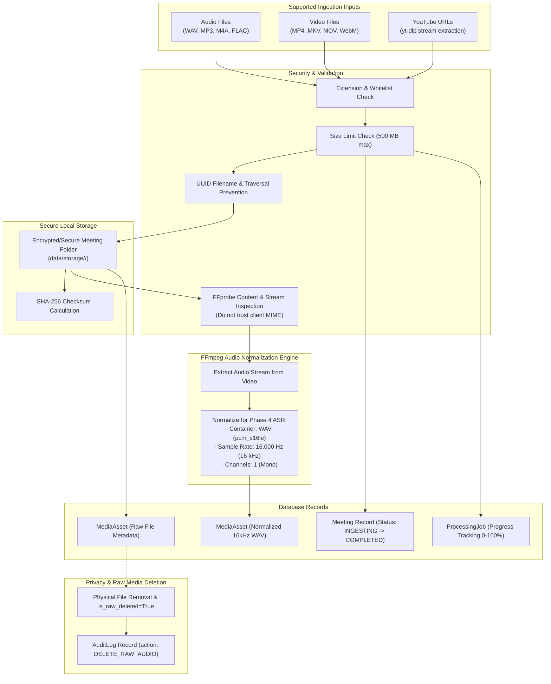
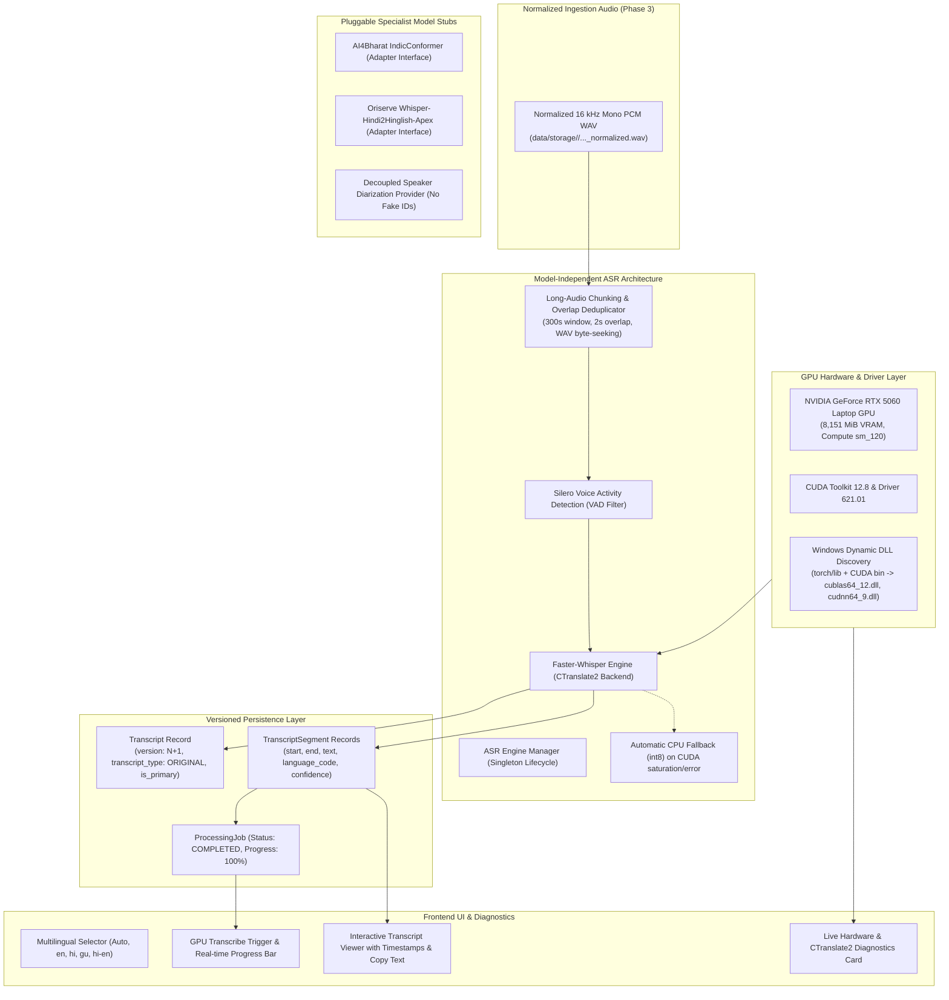

# Multilingual Meeting Intelligence System - Architecture

## 1. System Vision & Objective

The **Multilingual Meeting Intelligence System** is an enterprise-ready, privacy-first organizational memory platform designed to ingest, transcribe, analyze, and retain knowledge from multilingual meetings.

The core differentiators are:
- Ingestion of meeting media via Audio/Video uploads and YouTube streams.
- Automated media validation and ASR audio standardization (16 kHz mono WAV) using FFmpeg.
- Native support for multilingual speech, including English, Hindi, Gujarati, and Hinglish (code-switched conversations).
- Coexistence of original (raw ASR) and cleaned/redacted transcripts without data loss.
- Persistent organizational memory that indexes discussions, decisions, action items, deadlines, owners, and risks across time.
- Evidence-grounded Dual-Source Retrieval-Augmented Generation (RAG): combining internal meeting transcripts and external reference repositories.
- Privacy-first on-premise execution capability using local models (Whisper Large-v3 Turbo, Ollama-hosted LLMs, local ChromaDB).

---

## 2. Verified Hardware & Runtime Environment

| Component | Specification / Detected Value | Status |
| :--- | :--- | :--- |
| **CPU** | AMD Ryzen 7 260 w/ Radeon 780M Graphics (8 cores / 16 threads) | Verified |
| **System RAM** | 16 GB Physical RAM (15.31 GiB usable) | Verified |
| **Disk Space** | 812+ GB Free on Drive C: | Verified |
| **Dedicated GPU** | NVIDIA GeForce RTX 5060 Laptop GPU (8,151 MiB VRAM) | Verified |
| **GPU Driver** | NVIDIA Driver 621.01 (CUDA UMD 13.5) | Verified |
| **PyTorch & CUDA** | PyTorch 2.11.0+cu128 (CUDA 12.8 acceleration active) | Pre-installed & Verified |
| **FFmpeg & FFprobe** | FFmpeg 9.0.2-full_build (Gyan.dev build with libwhisper & audio decoders) | Verified & Active |
| **Python** | Python 3.13.16 (`C:\Users\gurpr\AppData\Local\Programs\Python\Python313\python.exe`) | Verified |
| **Node.js & npm** | Node.js v26.13.1 (LTS) & npm 11.20.0 | Installed & Verified |
| **Ollama** | Not yet installed | Planned for Phase 5 |

---

## 3. Media Ingestion & Lifecycle Pipeline (Phase 3)

---

## 4. Multilingual ASR Engine & GPU-Accelerated Transcription (Phase 4)

### Key Architectural Decisions for Phase 4:

1. **Hardware-Native Dynamic Linkage**:
   Windows Python 3.13 requires explicit DLL discovery for CTranslate2. `gpu_manager.py` dynamically registers both `site-packages/torch/lib` and the system CUDA 12.8 toolkit binary directory using `os.add_dll_directory` upon startup, allowing CTranslate2 to bind `cublas64_12.dll` and `cudnn64_9.dll` directly without manual system environment variable manipulation.

2. **PyAV 19 Compatibility Wrapper**:
   PyAV 19 removed the deprecated `metadata_errors` keyword parameter from `av.open`. A compatibility shim wraps `av.open` to transparently sanitize arguments, enabling uninterrupted streaming audio decoding in `faster_whisper.audio.decode_audio`.

3. **Lossless Byte-Seeking Chunking**:
   Long recordings (> 300 seconds) are segmented using standard Python `wave` frame seeking on normalized 16 kHz 16-bit mono PCM files, bypassing external process invocation. Segment boundaries with 2.0s overlap are aligned using absolute timestamp offsets and deduplicated to eliminate boundary stutter.

4. **Guaranteed Original Transcript Immobility**:
   Re-running transcription on a meeting creates a new version record (`version = max_version + 1`) rather than mutating or deleting previous runs, preserving full data provenance and auditability.

5. **Honest Diarization & Specialist Isolation**:
   Because Whisper is exclusively an ASR model, speaker identification is strictly decoupled via `DiarizationProvider`. Speaker IDs are left `None` rather than fabricated, and adapter interfaces for AI4Bharat IndicConformer and Whisper-Hindi2Hinglish-Apex are staged for upcoming evaluations.

---

## 5. Phase-by-Phase Roadmap

1. **Phase 1: Solid Foundation & Verification** (Completed)
   - Environment inspection, FastAPI setup, SQLite baseline, React+Vite+TS frontend, health check.

2. **Phase 2: Core Database Architecture & Migration Foundation** (Completed)
   - Full domain entity modeling with SQLAlchemy 2.0.
   - Alembic migration version control.
   - Comprehensive test suite for data isolation, multilingual segments, transcript versions, and foreign key enforcement.

3. **Phase 3: Media Ingestion & Audio Lifecycle** (Completed)
   - Audio/Video file upload and YouTube ingestion via `yt-dlp`.
   - FFmpeg 16kHz mono normalization for future ASR pipeline.
   - SHA-256 checksums, metadata extraction, safe deletion, and AuditLog recording.
   - Interactive UI with drag-and-drop upload, YouTube form, job progress tracking, and history.

4. **Phase 4: Multilingual ASR Engine & GPU-Accelerated Transcription** (Completed)
   - Faster-Whisper and CTranslate2 running on NVIDIA RTX 5060 Laptop GPU (CUDA 12.8, float16).
   - Audio chunking with overlap deduplication and silence handling.
   - Multilingual transcription (English, Hindi, Gujarati, Hinglish code-switching).
   - Versioned database persistence of transcripts and segments without overwriting.
   - Frontend transcription control, language selector, transcript viewer, and hardware diagnostics.
   - 41 backend unit, integration, and live hardware tests passing.

5. **Phase 5: Intelligence & Extraction Pipeline** (Next)
   - Ollama local LLM integration for automated summaries, decisions, action items, and risks.

6. **Phase 6: Dual-Source RAG & Cross-Meeting Memory** (Planned)
   - ChromaDB vector store, multilingual embeddings, and hybrid query routing.

7. **Phase 7: Enterprise Authentication & Privacy Controls** (Planned)
   - JWT RBAC, PII redaction engine, and immutable audit trails.
